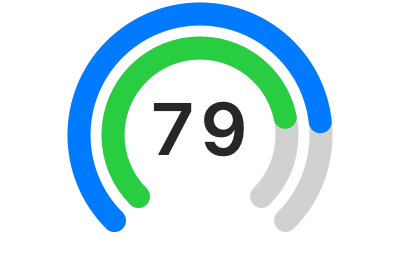

# Codex 额度菜单栏

macOS 菜单栏用双层四分之三圆环显示当前账号的 Codex 额度：外环为周额度，内环为 5 小时额度，中央只显示 5 小时剩余百分比的数字。每 60 秒刷新。点击菜单栏可查看已用比例、重置时间、手动刷新，并打开官方用量页面。



## 构建与运行

需要 macOS 13 或更新版本、Swift 编译器，以及已登录的 Codex 桌面应用或 CLI。在终端进入本项目目录，运行：

```sh
zsh build.sh
open "Codex Quota.app"
```

程序通过本机 `codex app-server` 的 `account/rateLimits/read` 读取额度，不保存登录凭据，也不会调用模型。请先运行 Codex 并完成登录。退出可在菜单栏菜单中选择“退出”。

“实时”指每分钟轮询一次服务端数据；菜单栏中的剩余百分比是服务端已用百分比的补数。

## 许可证

MIT，详见 [LICENSE](LICENSE)。
